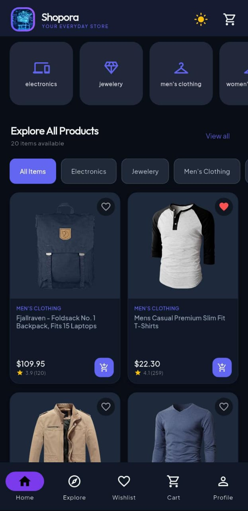
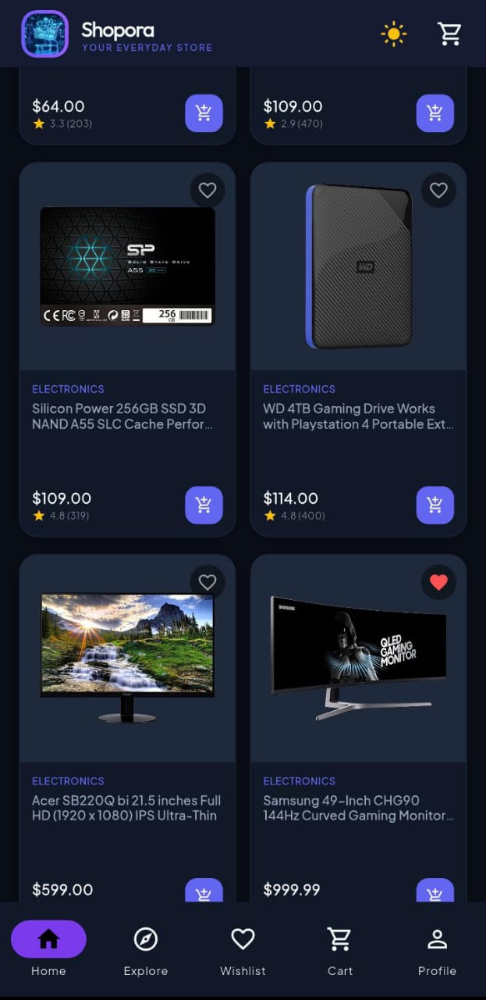

# Shopora - Premium Flutter E-Commerce Shopping App
**Task 05 (Advanced) – Internship Assignment Submission**


## Project Badges


Shopora is a production-quality, modern cross-platform shopping application built with **Flutter** and **Dart**, powered by live REST data from [Fake Store API](https://fakestoreapi.com/).
---

<p align="center">
  
  &nbsp;&nbsp;&nbsp;
  
</p>

---
## Architecture & Tech Stack

- **Framework**: Flutter 3.16+ / Dart 3.2+
- **State Management**: `provider` (ChangeNotifier architecture with `ProductProvider`, `CartProvider`, `WishlistProvider`, `ThemeProvider`)
- **Networking**: `http` with resilient error handling, status code checks, timeout guards, and in-memory caching
- **Local Persistence**: `shared_preferences` for cart items, wishlist favorites, theme mode, and order history
- **Image Caching & Fallbacks**: `cached_network_image` with shimmer skeleton placeholders
- **Design System**: Material 3, Google Fonts (`Plus Jakarta Sans` & `Outfit`), high-contrast accessible Light & Dark themes
- **Target Platforms**: Android, iOS, and Flutter Web

---

## Project Structure

```
flutter_shopora/
├── pubspec.yaml
├── lib/
│   ├── main.dart
│   ├── app.dart
│   ├── core/
│   │   ├── constants/
│   │   │   └── app_constants.dart
│   │   ├── theme/
│   │   │   ├── app_theme.dart
│   │   │   └── theme_provider.dart
│   │   └── utils/
│   │       └── formatters.dart
│   ├── models/
│   │   ├── product.dart
│   │   ├── cart_item.dart
│   │   └── order.dart
│   ├── services/
│   │   ├── product_api_service.dart
│   │   └── local_storage_service.dart
│   ├── repositories/
│   │   └── product_repository.dart
│   ├── providers/
│   │   ├── product_provider.dart
│   │   ├── cart_provider.dart
│   │   └── wishlist_provider.dart
│   ├── screens/
│   │   ├── home/
│   │   │   └── home_screen.dart
│   │   ├── catalog/
│   │   │   └── catalog_screen.dart
│   │   ├── product_details/
│   │   │   └── product_details_screen.dart
│   │   ├── search/
│   │   │   └── search_filter_screen.dart
│   │   ├── cart/
│   │   │   └── cart_screen.dart
│   │   ├── checkout/
│   │   │   └── checkout_screen.dart
│   │   ├── wishlist/
│   │   │   └── wishlist_screen.dart
│   │   └── profile/
│   │       └── profile_screen.dart
│   └── widgets/
│       ├── product_card.dart
│       ├── category_chip.dart
│       ├── loading_skeleton.dart
│       ├── empty_state.dart
│       └── error_state.dart
└── test/
    ├── cart_test.dart
    ├── product_test.dart
    └── filter_test.dart
```

---

## How to Run in VS Code / Terminal

### 1. Prerequisites
- Install Flutter SDK (version 3.16 or higher).
- Install VS Code with Flutter and Dart extensions.
- An active Android Emulator, iOS Simulator, or Chrome browser.

### 2. Setup Dependencies (PowerShell or Bash)
```bash
cd flutter_shopora
flutter pub get
```

### 3. Run the Unit Test Suite
```bash
flutter test
```

### 4. Run the Application
```bash
# Run on connected phone/emulator
flutter run

# Or run explicitly on Chrome (Flutter Web)
flutter run -d chrome
```

---

## Manual QA Verification Checklist

| Feature | Action | Expected Result |
|---|---|---|
| **API Loading** | App launch | Fetches 20 products and categories from FakeStore API; shows loading skeletons during fetch. |
| **Search** | Type "jacket" or "gold" | Live instant filtering by title & description (case-insensitive). |
| **Categories** | Tap "electronics" or "jewelery" | Products immediately filter to selected category with highlighted chip. |
| **Price Filter** | Drag slider in bottom sheet | Only products within min/max boundaries are displayed. |
| **Sorting** | Select "Price: Low to High" | Products correctly order from cheapest to most expensive. |
| **Product Details** | Tap any product card | Opens full details with high-res image, price, rating, quantity stepper, and related products. |
| **Cart Operations** | Add items, change quantity, delete | Cart count badge increments; subtotal, 8% tax, and shipping update dynamically. |
| **Cart Persistence** | Restart app / reload | Cart items and quantities remain intact from SharedPreferences. |
| **Wishlist** | Tap heart icon on card or details | Toggles favorite state, adds to dedicated wishlist screen, persists locally. |
| **Theme Switching** | Tap Sun/Moon in top bar or profile | Entire app switches seamlessly between Light & Dark themes; persists selection. |
| **Simulated Checkout** | Fill checkout form & submit | Validates required fields, generates simulated reference `SHP-2026-XXXXX`, clears cart, adds to order history. |
